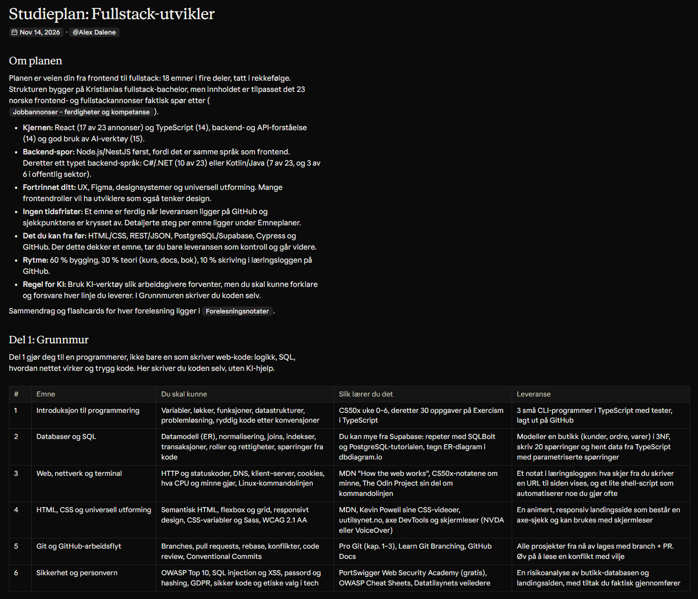

# Studieplan - Fullstack

Dette er mitt forsøk på å skaffe meg relevant og nødvendig erfaring som er
skreddersydd for arbeidsgivere i Norge.

> **Bruk av KI**: Jeg bruker KI til å hjelpe meg med å forstå begreper, planlegge og gi forslag til fremgangsmåter. Mitt spesifike oppsett er Claude, med **learn** skill (laget av Anthropic), for å tvinge fram svar som fokuserer på læring, og ikke bare for å utføre en oppgave. Dette er for å sikre etisk KI-bruk.

Studieplanen er laget av Claude, hvorav ressurser som har blitt brukt er fra studiet [Bachelor i Informasjonsteknologi - Fullstack-utvikling](https://www.kristiania.no/studier/bachelor/informasjonsteknologi-fullstack-utvikling/) fra [Kristiania](https://www.kristiania.no/). All informasjon som er hentet fra Kristiania, er fra dems egen [programbeskrivelse](https://www.kristiania.no/studieportal/fakultet-for-helse-og-teknologi/bachelorniva/bte/bachelor-i-informasjonsteknologi/), eller fra studiet sin landingsside, som er offentlig og tilgjengelig for alle.

Jeg har allerede **høyere fagskolegrad** (2 år) i [Frontend-utvikling](https://www.noroff.no/studier/fagskole/frontend-utvikling), fra Noroff, og en **fagskolegrad** (1 år) i [UX-design](https://gokstadakademiet.no/studier/ux-design/) fra Gokstad Akademiet.

## Ferdigheter

> Dette er basert på stillingsannonser som var ute ved den tid jeg lagde studieplanen. Det er verdt å merke seg at noen av disse er for senior roller, men det endrer ikke på det faktum at det er bra å kunne.

### Krav

| Ferdighet                                                                              | Forekomst |
| -------------------------------------------------------------------------------------- | --------- |
| Backend, REST-API-er og integrasjoner                                                  | Høy       |
| KI-verktøy i utviklingen (Claude Code, Cursor, Copilot) og kvalitetssikring av KI-kode | Høy       |
| React (ofte med Next.js)                                                               | Høy       |
| TypeScript/JavaScript                                                                  | Høy       |
| Databaser og SQL (PostgreSQL, MSSQL, MongoDB)                                          | Middels   |
| .NET/C# på backend                                                                     | Middels   |
| Java/Kotlin på backend                                                                 | Middels   |
| Sky (Azure, AWS, GCP)                                                                  | Middels   |
| UX, UI og visuelt design (Figma, prototyping)                                          | Middels   |
| CI/CD og DevOps (GitHub Actions)                                                       | Middels   |
| Testautomatisering og kodekvalitet                                                     | Middels   |
| Angular eller Vue                                                                      | Middels   |
| Sikkerhet                                                                              | Middels   |
| Git og versjonskontroll                                                                | Middels   |
| Universell utforming og tilgjengelighet                                                | Lav       |
| Python                                                                                 | Lav       |
| React Native                                                                           | Lav       |
| Node.js/NestJS                                                                         | Lav       |
| Scripting og automatisering                                                            | Lav       |

### Fordel å kunne

| Ferdighet                                                                                                                         |
| --------------------------------------------------------------------------------------------------------------------------------- |
| KI i produktet: LLM-er, RAG, embeddings, vektordatabaser, AI-agenter, MCP, tool calling og KI-plattformer (Azure AI Foundry o.l.) |
| Agentisk utvikling: bruke kodeagenter effektivt og beholde eierskapet til kvaliteten                                              |
| Design i praksis: Figma/Penpot, designsystemer og tokens, tjenestedesign                                                          |
| Innhold og publisering: Sanity og andre headless CMS, WordPress, SEO                                                              |
| Ytelse og kvalitet: hastighet, responsivt design, skalerbarhet, testing med skjermlesere                                          |
| Bygg og verktøy: Vite, npm, Next.js, Remix/React Router, Vercel                                                                   |
| Testrammeverk: Playwright, Vitest, JUnit, WireMock og Cucumber                                                                    |
| Java-økosystemet: Spring Boot, Maven/Gradle, Jenkins og Nexus                                                                     |
| Arkitektur: mikrotjenester, micro-frontends, Backend For Frontend, distribuerte systemer og modernisering av eldre løsninger      |
| API-er: GraphQL i tillegg til REST                                                                                                |
| Hendelsesbasert arkitektur: Kafka og webhooks                                                                                     |
| DevOps og drift: Docker/Podman, Kubernetes, OpenShift, Linux, Grafana, Splunk og observabilitet                                   |
| Infrastruktur som kode: Terraform, Bicep og PowerShell                                                                            |
| Backend-verktøy: Python med FastAPI                                                                                               |
| Sikkerhet og regelverk: autentisering, identitetsstyring, personvern, GDPR og sikker kode                                         |
| Arbeidsform: GitHub, smidig/Kanban, parprogrammering, kodegjennomgang og dokumentasjon                                            |
| Verktøy: Microsoft 365 og Graph, Jira og andre ITSM-verktøy                                                                       |

## Studieplan

Basert på ferdighetene som trengs i markedet, og studieplanen til Kristiania, så fikk jeg Claude til å lage en skreddersydd studieplan som følger samme oppsett, men legger også vekt på det jeg burde kunne. I bildet ser man tydelig oppsettet til planen, hvor hvert emne har en følgende forklaring, forslag til læringsmåte og oppgaver.

